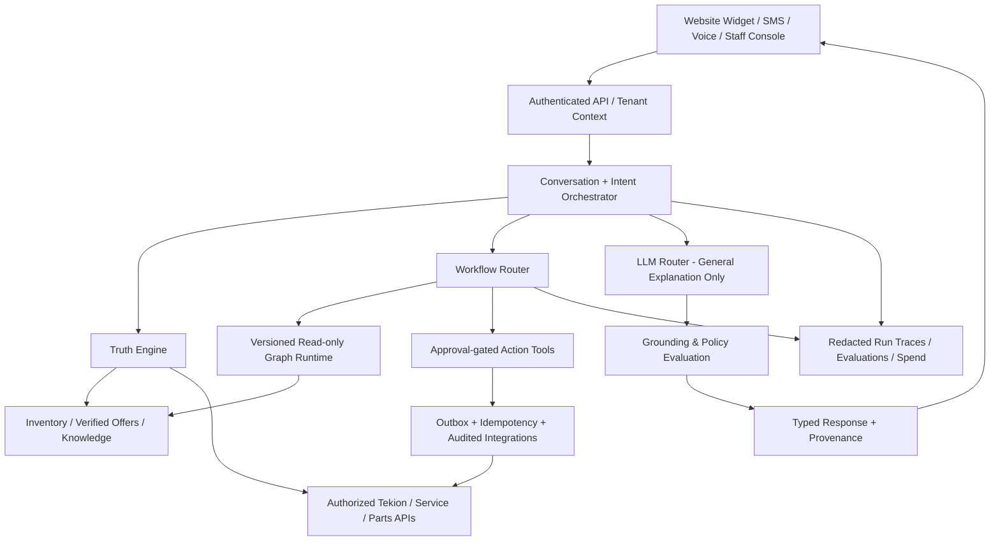

# AMQUR: Dify-inspired capability adoption plan

**Status:** Engineering blueprint and Stage 0 read-only preview implementation; **not** a claim of Dify parity.  
**Reviewed:** 2026-11-17  
**Sources:** User-supplied `dify-main.zip` (Dify 1.19.0, `README.md`, `LICENSE`, directory structure), AMQUR `amqur-backend` and `amqur-widget` default branches, AMQUR platform project reference.

## Decision / legal boundary

Dify's `LICENSE` is **modified Apache-2.0**, not unmodified Apache-2.0. It states Dify source code may not be operated as a **multi-tenant environment** without explicit written permission / a commercial license; using its frontend also carries logo and copyright restrictions. AMQUR serves independent tenant dealerships. **Do not fork, copy/paste source, redistribute rebranded Dify UI, or deploy a Dify server as our multi-tenant SaaS without a license review and approval.**

This plan implements *similar capabilities through original code* in the existing AMQUR architecture. It does **not** implement a pixel-faithful Dify interface. Only independently authored AMQUR code is allowed in the integration. Seek legal review before any proposed use of Dify artifacts. Official upstream reference: https://github.com/langgenius/dify/blob/main/LICENSE .

## Product boundaries

1. The AMQUR Truth Engine remains the **authority** for facts. Never fabricate VINs, inventory, prices, incentives, APR, hours, service/parts pricing, financing terms, store policies, appointment availability, or staff data.
2. **Tekion remains the dealership's CRM system of record.** Existing Google/Meta/web leads continue entering Tekion through the dealership's authorized ADF/XML routing; AMQUR adds a tenant-scoped engagement and analytics layer, not a shadow lead source that breaks attribution. Any CRM write is opt-in, audited and idempotent.
3. A dealer group's reporting scope is not permission to mix rooftop tenants. Retain `tenantId` on every read/write, principal-scope enforcement, tenant-aware cache keys, and positive/negative isolation tests.
4. Live customer workflows must be grounded and deterministic when authority data is absent. A model may explain *general* information, but not invent dealership-specific facts.
5. No unrestricted Dify-style code nodes, arbitrary URL tools, free-form MCP execution, external file system access, or agent-admin permissions on the public widget.
6. All new features are modular, opt-in per tenant and location, backward-compatible, monitored, documented and disabled in production until explicitly enabled and validated.

## Source-based capability matrix

Status definitions: **Existing** = verified in AMQUR source; **Partial** = base implementation but significant gap; **New** = not verified as general platform feature; **Defer** = intentionally not a near-term customer feature.

| Capability category | Evidence from uploaded Dify | AMQUR baseline verified in source | Priority / decision |
|---|---|---|---|
| Conversational assistant | Agent, chat and app components | `ChatOrchestrator`, React/Vite widget | P0 Preserve, enhance evidence |
| Multi-tenant workspaces | Workspace models and services | Tenant, Location, DealerGroup, JWT roles | P0 Preserve isolation, do **not** port license-restricted Dify multi-tenant code |
| Grounded answers / citations | RAG retrieval and answer components | SourceAuthority, GroundingGuard, KnowledgeRetrieval | P0 Verify citations and provenance end-to-end |
| Knowledge ingestion | Dify RAG extractors, index processors | KnowledgeIngestion, website ingestion | P1 Add connectors and file format support safely |
| Semantic vector retrieval | Embedding, rerank, retrieval code | `DisabledEmbeddingProvider`, keyword scoring | P0 Add configurable embedding + pgvector, hybrid ranking |
| Knowledge metadata filters | Dataset metadata and retrieval nodes | Tenant, location, visibility, publication time | P0 Preserve, extend source-level filters |
| Knowledge review and publication | Dataset access and workflow | KnowledgeLifecycle exists | P0 Reuse draft/approval/publish gates |
| Knowledge hit testing | Dataset hit-testing UI | Staff Knowledge preview endpoint | P1 Improve evaluation and relevance grading |
| Multi-model routing | Provider ecosystem | `LlmRouterService` for OpenAI + Anthropic | P1 Add provider registry only when justified |
| Prompt lab | Dify Prompt IDE | Versioned playbooks, Conversation Studio | P1 Compare prompts, ground-truth evaluations |
| Visual workflows / chatflows | Dify workflow canvas, graph nodes | No generalized graph designer verified | P0 Start with safe backend schema/preview; P1 visual editor |
| Triggered workflows | Schedule and webhook trigger nodes | Existing business jobs and webhook inbox | P1 Approved trigger registry; no arbitrary webhooks |
| Conditional routing | Branch/if-else and classifier nodes | Chat orchestration branches | P0 Read-only graph validation/preview |
| Human-in-the-loop | Human input and review nodes | Escalations and approval services in domain flows | P0 Explicit approval gate for agent writes |
| Tool invocation | Builtin/custom/MCP/workflow tools | Typed dealership adapters, integration module | P1 Whitelisted tool catalog with per-role policies |
| MCP clients | `core/mcp` | No broad MCP agent registry verified | P2 Staff-only approved integrations and auditing |
| Code execution sandbox | Code nodes / agent runtime | Not approved for public assistant | **Defer**; only if separately isolated and justified |
| General autonomous agent | `dify-agent` package | Chat orchestrator and specialized services | P2 Scoped employee agents, not unbounded autonomy |
| Workflow versioning and replay | Workflow DSL import, logs | Versioned playbooks, experiments | P1 Workflow versions, run/step history, replay |
| Agent evaluation | Evaluation manager, frameworks and judgments | Experiments and metrics | P1 Golden-case evaluations, pre-release gates |
| Prompt/model A/B tests | Application monitoring and evaluation | Greeting experiments | P1 Expand to policy-gated prompt variants |
| LLMOps / observability | Tracing, logs, providers | Metrics, analytics, spend caps, failover | P1 Trace per turn and per workflow node |
| API-first embedding | Dify service and web APIs | Existing public and private REST endpoints | P0 Extend existing APIs, do not duplicate API surface |
| Embeddable chat app | Dify app publisher | AMQUR Shadow DOM widget | P0 Reuse AMQUR widget and design |
| Vehicle cards, quotes and trade | Dify generic cards / forms | AMQUR vehicle/finance/trade modules | P0 AMQUR-specific advantage, preserve |
| Live knowledge/offer accuracy | Generic Dify knowledge | Source freshness & authority rules | P0 AMQUR-specific advantage, preserve |
| Usage and cost reporting | Model and trace metrics | LLM budget/circuit breaker and analytics | P0 Preserve strict per-tenant caps |
| Templates / marketplace | Dify app templates and plugin marketplace | No general marketplace verified | P2 Curated dealership recipes, no unreviewed plugins |
| Team permissions | Dify collaboration and workspace | JWT, RBAC, MFA and location scope | P0 Preserve and add approval separation of duties |
| Voice / omnichannel | Agent integrations | Voice and Messaging modules | P2 Proceed with actual verified provider access |

The absence of a feature from this matrix does **not** prove it is absent from the entire backend; source reads are limited to the reviewed modules. Verify each gap before starting implementation.

## Architecture target



**Keep original stack:** NestJS / TypeScript, PostgreSQL / Prisma, Redis, workers, Next.js or existing React Command Center, React/Vite Shadow DOM widget. No Python/Flask migration to accommodate Dify. Prefer controlled `pgvector` queries and migration over introducing an independent vector platform prematurely.

## Stage 0: workflow laboratory — code in this PR

The new `WorkflowLabModule` exposes an authenticated **staff-only preview** API:

`POST /api/ops/workflow-lab/preview`

Example payload:

```json
{
  "query": "What is the verified warranty policy?",
  "locationId": "<authorized-location-id>",
  "graph": {
    "version": 1,
    "nodes": [
      { "id": "start", "type": "start", "next": "knowledge" },
      { "id": "knowledge", "type": "knowledge_search", "next": "branch", "limit": 3 },
      { "id": "branch", "type": "branch_on_verified_sources", "whenFound": "done", "whenMissing": "review" },
      { "id": "done", "type": "end" },
      { "id": "review", "type": "human_review", "reason": "A dealership specialist must confirm this information" }
    ]
  }
}
```

The handler derives tenant from staff JWT, resolves location via existing RBAC policy, fetches **published customer-visible** knowledge only and returns `mode: preview`, trace, source titles/IDs/scores and `status: complete | blocked_pending_review`. The graph validator rejects unsupported nodes (code, HTTP, external tools), cycles, missing edges, unreachable nodes, oversized graphs, and unbounded retrieval. Human-review nodes **stop**; they never approve or perform an action. No workflow definitions are persisted, no CRM writes or model calls occur, and chat/widget behavior is unchanged.

This is deliberately **not** a production workflow runner or human-approval inbox. It is the safe development foundation for later capabilities. The `complete` preview status means the simulated graph terminated, **not** that a dealership fact was proven accurate or an action took place.

### Stage 0 test gates

- Valid branched graph returns source IDs without raw CRM or customer PII.
- Missing published sources go to blocked human review, not a fabricated answer.
- Graph cycles, duplicate IDs, unknown nodes, missing edges, unreachable states and overlarge limits fail closed.
- Customer widget JWT cannot call staff preview endpoint; cross-tenant and cross-location attempts are denied by existing auth/role/location guards.
- No network tool execution, automatic actions, or database writes are reachable.
- Lint, TypeScript, Jest, e2e auth/isolation, API smoke all green before merge; no automatic production rollout.

## Next implementation phases

### P0 / Truth and tool foundation

- Semantic RAG behind an off-by-default tenant feature flag; verified embedding provider, vector migration with rollback, hybrid scoring, metadata/tenant filters, provenance and retrieval evaluations.
- Versioned workflow definitions and immutable run snapshots with Prisma migrations and transaction safety.
- A typed **read-only** tool registry: inventory search by VIN/filters, published knowledge search, verified store info, dealership appointments availability read only when supported by an authorized provider.
- Source-level caches tenant-scoped and invalidated on feed freshness or publication changes.

**Acceptance:** 100% negative tenant-isolation suite; 0 unverified factual claims in golden cases; no increase in P95 chat response latency beyond agreed SLO; no unintended writes.

### P1 / Workflow editor + approvals + eval studio

- Command Center visual DAG designer using independently authored React components; graph edit, version/diff, draft/publish/rollback and branch preview.
- Human approval records with independent approver, timeout, deny/revoke, immutable actor/context and audit trail.
- Approved write tools only: CRM note/update, escalation, appointment request and outreach *after* permissions/consent/idempotency checks.
- Prompt studio and golden-case evaluations (sales, service, parts, finance, safety, hallucination, tenant isolation, data freshness), trace viewer and cost dashboard.

**Acceptance:** Every write yields trace + audit ID; deny/no-response causes no write; duplicate retries do not create multiple leads; traces redact PII and secrets.

### P2 / Agent and connector ecosystem

- Department-specific assistants (Sales, Service, Parts, Finance, Reception, Internal Ops), safe tool routing, multi-turn state and deterministic fallbacks.
- Curated integration connectors (Tekion and approved vendor APIs); no unapproved MCP server access. Per-tenant scope and credentials in vault.
- Consent-aware follow-up campaigns and provider-triggered automations with operational SLOs, observability and a kill switch.
- Open model adapters or specialized model comparison only after economics/security benchmarks.

**Acceptance:** Each integration passes contract, permission, replay, rate-limit and outage tests; no side effects without authorized actor and published workflow.

### P3 / Advanced experiences

- Voice receptionist, staff co-pilot, visual multimodal assistant, richer document extraction, batch processing, partner marketplace — only when ROI and data rights are clear.
- Deliberately **exclude** arbitrary unsandboxed Python/JS execution from public chat. If a private code sandbox is ever necessary, isolate by tenant, block secrets and network by default, apply CPU/memory/time budgets and security review.

## Data contracts (future migration plan; not part of Stage 0)

- `WorkflowDefinition`: tenant, optional location, key, department, status, draft/published version, author/approver, policy and timestamps.
- `WorkflowVersion`: immutable graph JSON, schemaVersion, digest, change reason, reviewedAt and rollback reference.
- `WorkflowRun`: tenant, location, workflowVersion, triggering conversation/actor, input digest, status, started/completedAt and error classification.
- `WorkflowStepRun`: runId, nodeId, attempt, status, redacted input/output references, correlation ID, latency and cost.
- `ActionApproval`: runId, stepId, tool, payload digest, requestedBy, approved/deniedBy, decision timestamp and expiry.
- `ToolRegistration`: fixed key, department, allowed roles, tenant feature gate, idempotency contract, allowed egress target, read/write category and approval policy.

Use Prisma migrations only. Reference tenant FK and tenant-scoped unique constraints/indexes; row permissions must be enforced *inside services*, not only in UI. Multi-rooftop reports use explicit DealerGroupMembership rather than weakening tenant isolation.

## Tool safety contract

Every eventual tool invocation requires `{ tenantId, locationId, actorId, actorRole, toolKey, operation, purpose, correlationId, idempotencyKey }`. Runtime derives tenant and actor from signed context; never from a model-generated JSON payload. A policy engine checks active tenant configuration, role, allowed location, source authority, required customer consent, approval and per-tool quota. Write-intent payloads are validated against approved DTO schemas. Postgres outbox ensures retries are idempotent. External responses are untrusted data and must not become new agent instructions.

## Lead-routing principle

Keep the user's approved Tekion routing (Google Ads / Meta Ads / website ADF/XML intake -> Tekion). AMQUR may retrieve consented lead context and append authorized, deduplicated conversation notes or appointment requests once the vendor contract is verified. Do not create duplicate ad-source leads, replace the store's email routing, or claim confirmed Tekion writes without evidence of successful API response.

## Release controls and honest status

**Implemented by Stage 0:** Read-only graph parsing, validation, published-knowledge preview, safe review halt, authenticated staff endpoint, tests; pending CI and reviewer signoff.  
**Not implemented by Stage 0:** Visual editor, durable orchestration, agents, tool writes, semantic vector retrieval, connector marketplace, production rollout, complete Dify parity.

Merge only after CI and security review. Production customer traffic remains governed by existing fail-closed flags, infrastructure gating, canary and owner approval; no automatic activation as a side effect of this feature PR. Keep feature progress in the engineering issue tracker with evidence, not an unearned 100/100 score.
